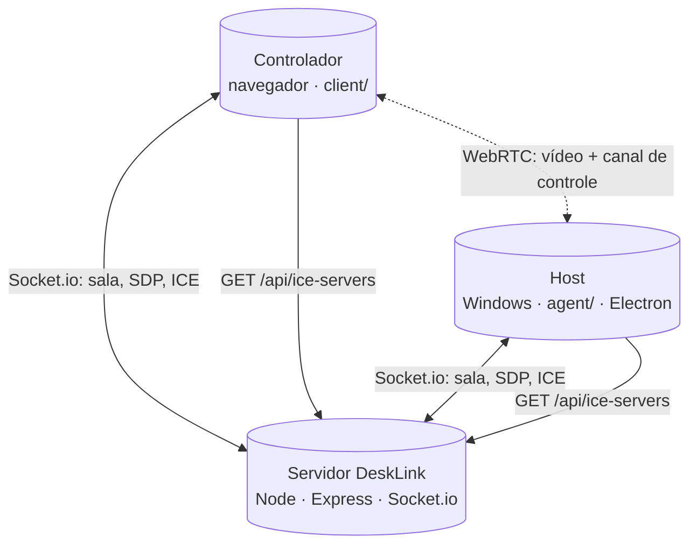

# DeskLink

DeskLink é um projeto de acesso remoto em tempo real: um PC compartilha a tela (**host**) e outro PC controla pelo navegador (**controlador**). Vídeo e comandos trafegam por WebRTC; o servidor Node faz a sinalização da sessão e fornece configuração ICE.

## 📌 Status do projeto

- Estágio atual: protótipo funcional com foco em uso pessoal e evolução incremental.
- Plataformas: host e servidor em Windows x64 (Electron) e controlador em navegador moderno.
- Escopo atual: 1 host + 1 controlador por sessão.

## ✨ Recursos principais

- Streaming de tela com WebRTC.
- Controle remoto de mouse e teclado.
- Troca de monitor remoto em hosts com múltiplos displays (`Shift+F8` no controlador).
- Modo **caneta** no controlador (`Shift+F9` ou checkbox): desenha anotações vermelhas que aparecem como overlay no host, sem mover o mouse remoto enquanto o modo estiver ativo.
- Modo somente visualização (desabilita envio de input).
- Sincronização opcional de clipboard (texto) entre controlador e host.
- Ajuste de sensibilidade de rolagem em tempo real (baixa/média/alta).
- Chat em tempo real entre controlador e host, com suporte a emojis.
- No controlador: estado **ICE/caminho** (incl. uso de TURN), **métricas leves** de sessão e **perfil de vídeo** (economia de dados / balanceado / qualidade máxima).
- Notificações de nova mensagem:
  - controlador: Web Notification (apenas quando aba/janela não está ativa);
  - host (Windows): notificação nativa + piscar na barra quando a janela está sem foco/minimizada.
- **Reconexão automática:** quedas involuntárias de rede ou WebRTC disparam nova tentativa (Socket.io + renegociação WebRTC) sem exigir reinício do servidor ou do túnel.
- **Retorno do controlador:** se o host ainda estiver compartilhando, a sessão WebRTC é restabelecida automaticamente quando o controlador volta com o mesmo código (grace period de ~45s no servidor).
- **DeskLink Server:** app Electron com interface visual para iniciar o servidor de sinalização e o túnel Cloudflare, exibir a URL gerada e abri-la automaticamente no navegador padrão.

---

## 🏗️ Arquitetura

| Pacote | Papel | Tecnologias principais |
|--------|-------|-------------------------|
| `server/` | Sinalização entre peers, API e arquivos estáticos do controlador em produção | Node.js, Express, Socket.io |
| `client/` | Aplicação web do controlador (vídeo remoto + envio de comandos) | Vite, TypeScript, socket.io-client, WebRTC |
| `agent/` | Aplicativo host desktop (captura de tela + injeção de input no SO) | Electron, TypeScript, nut-js |
| `agent-server/` | Aplicativo servidor desktop (gerencia servidor de sinalização + túnel Cloudflare) | Electron, TypeScript, esbuild |

Fluxo simplificado:



Observação: o tráfego de mídia não passa pelo processo Node do DeskLink; passa entre peers (direto ou via TURN, quando necessário).

---

## 🧰 Stack e tecnologias

- Runtime: Node.js 18+.
- Backend: Express + Socket.io.
- Frontend controlador: Vite + TypeScript.
- App host: Electron + TypeScript + esbuild.
- App servidor: Electron + TypeScript + esbuild.
- Automação de build: electron-builder.
- Input nativo no host: `@nut-tree-fork/nut-js`.

---

## ✅ Pré-requisitos

| Item | Detalhe |
|------|---------|
| Node.js | 18+ ([nodejs.org](https://nodejs.org)) |
| Sistema para host/servidor | Windows x64 |
| Dependências nativas (opcional) | [Visual Studio Build Tools](https://visualstudio.microsoft.com/visual-cpp-build-tools/) podem ser necessários caso o `electron-rebuild` precise compilar a partir do código-fonte (caso não haja binários pré-compilados). |
| Wizard/Installer | [Inno Setup 6](https://jrsoftware.org/isdl.php) instalado (precisa do `ISCC.exe`). Se o `ISCC.exe` não estiver em `C:\Program Files (x86)\Inno Setup 6\ISCC.exe`, defina `ISCC_PATH` antes do build. |

---

## 🚀 Quick start (desenvolvimento local)

```bash
git clone <seu-repositorio>
cd DeskLink
npm install
```

🔹 Terminal 1 (server + client):

```bash
npm run dev
```

🔹 Terminal 2 (agent host):

```bash
npm run dev -w agent
```

🔹 Terminal 3 (opcional — app servidor Electron):

```bash
npm run dev -w agent-server
```

> O app **DeskLink Server** embute o servidor Node e o controlador web; em dev, ainda é comum usar `npm run dev` + `desklink-externo.bat` para expor o túnel.

📍 Endpoints em dev:

- API/Socket.io: `http://localhost:3000`
- Controlador web: `http://localhost:5173` (com proxy para `/api` e `/socket.io`)

🧭 Fluxo de uso:

1. Inicie `npm run dev`.
2. No host (Electron), informe `http://localhost:3000`, copie o UUID e inicie compartilhamento.
3. No controlador (navegador), use a mesma URL + mesmo UUID e conecte.

---

## 🖥️ Uso durante a sessão

- Clique na área remota para capturar mouse/teclado no controlador.
- "Habilitar controle remoto" desmarca para modo somente visualização.
- `Shift+F8` (ou botão de monitor) alterna monitor remoto ativo quando houver múltiplos displays.
- Atalhos no **controlador** (`Shift+Fx`, sem Ctrl/Alt/Meta, com o painel remoto visível): `Shift+F6` alterna sincronização de clipboard; `Shift+F7` alterna "Habilitar controle remoto"; `Shift+F8` solicita troca de monitor no host; `Shift+F9` liga/desliga o **modo caneta** (anotações no host — traço vermelho; enquanto ativo o mouse não envia `move`/cliques/rolagem ao remoto; mesmo efeito que o checkbox **Modo caneta (anotações no host)**); `Shift+F10` foca a área remota na página; `Shift+F11` alterna **tela cheia** da área remota. `F1`–`F12` sem Shift (ou com Ctrl/Alt) são enviadas normalmente ao host. Ao desligar o modo caneta ou ao desconectar, as anotações no host são limpas.
- Teclado: caracteres (inclusive acentos `´ ` ~ ^ ¨` e AltGr) são resolvidos pelo layout do **controlador** e digitados no host via Unicode, sem trocar o idioma do host; atalhos com Ctrl/Alt/Win, teclas especiais e letras sem acento seguem como tecla física.
- A rolagem usa normalização e coalescência para reduzir picos de eventos.
- O seletor de sensibilidade de rolagem aplica sem reconectar (baixa/média/alta).
- **Conexão e rede (só no controlador):** acima dos atalhos aparecem pills com o estado **ICE** (negociação WebRTC), o **caminho** estimado (rede local, NAT na internet ou **relay via TURN**) e uma linha de **métricas** (RTT aproximado, fps recebido, perda de pacotes e qualidade *Boa / Instável / Ruim*). Passe o mouse para ver dicas em português. Se a conexão falhar com frequência entre redes diferentes, confira TURN no servidor (`METERED_*` ou `ICE_SERVERS_JSON`).
- **Perfil de vídeo (só no controlador):** o seletor *Economia de dados*, *Balanceado* ou *Qualidade máxima* pede ao host para ajustar FPS/bitrate de envio (sem mudar a interface do host). A escolha é lembrada neste navegador (`localStorage`). Um aviso ao lado confirma se o host aplicou o perfil.
- Para comandos de sistema, prefira o painel de atalhos.
- Chat durante a sessão:
  - `Enter` envia mensagem;
  - `Shift+Enter` quebra linha;
  - botão de emoji abre o seletor acima do botão;
  - tecla `Win+Ç` também abre o seletor (quando o navegador/SO permite capturar a combinação).
- No host (agent), ao conectar:
  - as seções "Servidor" e "Código da sessão" ficam ocultas para priorizar "Tela" e "Conversa com o controlador";
  - a área de mensagens do chat se ajusta dinamicamente quando a área digitável é redimensionada.
- **Reconexão e desconexão:**
  - Quedas involuntárias (rede, WebRTC): o controlador mostra estado *Reconectando…* e tenta restabelecer a sessão; o host reconecta ao servidor e, se ainda estiver compartilhando, renegocia o vídeo quando o controlador volta.
  - Use **Desconectar** no controlador (ou **Parar** no host) apenas quando quiser encerrar a sessão de propósito — isso evita reconexão automática.
  - Enquanto o host mantém o compartilhamento ativo, o controlador pode sair e voltar com o mesmo UUID dentro de ~45s sem precisar clicar de novo em *Iniciar compartilhamento* no host.
  - Após reconectar, o host envia um reset de input e o estado do monitor ativo; aguarde o indicador de monitor antes de controlar o remoto (evita cliques fora de sincronia).

---

## 🏭 Rodando em produção

```bash
npm run build
npm run start -w server
```

O servidor entrega `client/dist` e a API na mesma origem (recomendado para reduzir problemas de CORS).

### 🔐 Variáveis de ambiente (`server/.env`)

```bash
cp server/.env.example server/.env
```

| Variável | Uso |
|----------|-----|
| `PORT` | Porta HTTP (padrão `3000`) |
| `CLIENT_ORIGIN` | CORS (em produção, defina origem real do controlador) |
| `METERED_DOMAIN` / `METERED_API_KEY` | Configuração TURN via Metered |
| `ICE_SERVERS_JSON` | Lista ICE estática (substitui Metered quando definida) |

Não faça commit de `.env` com chaves reais.

---

## 🌐 ICE, STUN e TURN

- `GET /api/ice-servers` fornece a configuração ICE para host e controlador.
- STUN ajuda descoberta de endereço para tentativa P2P.
- TURN faz relay quando conexão direta falha (comum entre redes/NAT diferentes).
- Em internet real, TURN costuma ser necessário para boa taxa de conexão.

Exemplo Metered em `server/.env`:

```env
METERED_DOMAIN=desklink.metered.live
METERED_API_KEY=sua_chave_aqui
```

Exemplo de lista estática (`ICE_SERVERS_JSON`, PowerShell):

```powershell
$env:ICE_SERVERS_JSON='[{"urls":["turn:turn.example.com:3478"],"username":"u","credential":"p"}]'
```

---

## 🛠️ Helpers e scripts de operação

### 📦 Scripts NPM (raiz)

- `npm run dev`: sobe server + client em paralelo.
- `npm run build`: build de client, server e agent.
- `npm run start`: inicia servidor compilado.

### 🖥️ Scripts Windows (raiz)

| Arquivo | Função |
|---------|--------|
| `desklink-server.bat` | Instala dependências se necessário, compila client/server quando faltar `dist` e inicia servidor |
| `desklink-externo.bat` | Inicia servidor + túnel Cloudflare em conjunto (conveniente para desenvolvimento) |
| `desklink-tunnel.bat` | Inicia somente o túnel Cloudflare para expor `localhost:3000` |
| `desklink-build-agent.bat` | Build completo (host + servidor Electron) e geração do wizard unificado em `agent/installer/publish/` |

### 🧱 Build/release (pontos importantes)

- `desklink-build-agent.bat` executa as seguintes etapas em sequência:
  1. `npm install`
  2. Build do `client/`
  3. Build do `server/`
  4. Geração do ícone do host (`agent/build/icon.ico`)
  5. Empacotamento do host Electron (`DeskLinkHost.exe`)
  6. Geração do ícone do servidor (`agent-server/build/icon.ico`)
  7. Empacotamento do servidor Electron (`DeskLinkServer.exe`)
  8. Compilação do wizard unificado via Inno Setup
- O controlador usa `GET /api/brand-icon`, servido de `agent/build/icon.png`; em deploy/CI, garanta esse arquivo no host do servidor. No **DeskLink Server** empacotado, esse mesmo arquivo é incluído como `brand-icon.png` para o controlador web servido pelo app.
- O **DeskLink Server** usa ícone próprio em `agent-server/build/icon.png` (versionado no repo, como o Host). Edite o PNG e rode `npm run build-icon -w agent-server` para regenerar o `.ico`. Para recriar o PNG a partir do Host: `npm run generate-icon-source -w agent-server`. O atalho usa o ícone embutido em `DeskLinkServer.exe` (após `patch-server-icon.mjs`).

### 🚚 Wizard de expedição unificado

O instalador `DeskLinkDeployWizard.exe` pede ao usuário qual papel instalar:

- **Host:** instala `DeskLinkHost.exe` — o app Electron para compartilhar a tela. O código de sessão gerado é enviado ao controlador remoto.
- **Servidor:** instala `DeskLinkServer.exe` — o app Electron com interface visual que:
  - inicia o servidor de sinalização embutido (porta 3000);
  - estabelece automaticamente um túnel Cloudflare (`cloudflared`);
  - exibe a URL pública gerada (copiável com um clique);
  - abre o controlador web no navegador padrão.

> **Nota sobre `cloudflared`:** para usar o túnel no `DeskLinkServer.exe` fora do instalador (em desenvolvimento), coloque `cloudflared.exe` em `agent-server/resources/`. No instalador final, o executável pode ser incluído em `agent/installer/payload-server/resources/`.

**Payloads do wizard (estrutura otimizada):**

O installer usa três diretórios de payload gerados automaticamente pelo build (em `agent/installer/`):

| Diretório | Conteúdo | Condição |
|-----------|----------|----------|
| `agent/installer/payload-common/` | Runtime Electron (DLLs, pak files, locales, ~170 MB) | Sempre instalado |
| `agent/installer/payload/` | `DeskLinkHost.exe`, `icon.ico`, `resources/` do Host | Só quando Host selecionado |
| `agent/installer/payload-server/` | `DeskLinkServer.exe`, `icon.ico`, `resources/` do Servidor | Só quando Servidor selecionado |

O runtime Electron é **idêntico entre Host e Server** (~170 MB) e empacotado **uma única vez**, reduzindo o tamanho do `DeskLinkDeployWizard.exe` em relação à duplicação anterior.

Diretórios padrão sugeridos pelo wizard: `%LocalAppData%\DeskLinkHost` e `%LocalAppData%\DeskLinkServer`.

Scripts individuais de build/payload:

- `npm run pack:agent -w agent`: pipeline completo do host (ícone + electron-builder + `payload-common/` + `payload/`).
- `npm run pack:agent -w agent-server`: pipeline completo do servidor (ícone + electron-builder + `payload-server/`).
- `npm run build:deploy-wizard -w agent`: compila o wizard via Inno Setup em `agent/installer/publish/DeskLinkDeployWizard.exe`.

O wizard roda sem admin, atualiza arquivos no diretório escolhido e cria atalho na Área de Trabalho **somente se ainda não existir** (Host: `DeskLink Host`, Server: `DeskLink Server`). Não há desinstalador dedicado: remover pasta/atalho manualmente quando necessário.

> **Reinstalação inteligente:** ao ser executado em uma máquina onde já houve uma instalação anterior, o wizard detecta automaticamente os atalhos existentes (Host e/ou Servidor) e pré-seleciona o papel correspondente, preenchendo o diretório de destino com o caminho já instalado. Se ambos estiverem presentes, o Host é pré-selecionado por padrão.

> **Atalho com ícone antigo:** se o atalho já existia antes de uma atualização de ícone, apague-o manualmente e reexecute o wizard — o instalador não sobrescreve atalhos existentes.

---

## 🧪 Testes e validação

Atualmente o repositório não possui suíte automatizada de testes (unitários/de integração/e2e) nem scripts de lint dedicados na raiz.

Validação recomendada antes de publicar release:

1. `npm install`
2. `npm run build`
3. `desklink-build-agent.bat` (ou equivalente NPM)
4. Validar manualmente:
   - conexão host/controlador;
   - troca de monitor remoto (`Shift+F8`);
   - rolagem em baixa/média/alta;
   - clipboard opcional habilitado;
   - chat (envio com `Enter`, quebra com `Shift+Enter`, emojis e notificações em segundo plano);
   - endpoint `GET /api/brand-icon`;
   - reconexão do controlador (desconectar e conectar de novo com host ainda compartilhando): um clique = um clique no host;
   - várias reconexões seguidas na mesma aba do navegador (sem cliques/teclas duplicados);
   - queda simulada de rede com modificador pressionado (ex.: Shift): após reconectar, tecla não deve ficar presa no host;
   - `DeskLinkServer.exe`: inicialização do servidor embutido, exibição do túnel URL, abertura no navegador e ícone distinto do Host (atalho e executável);
   - wizard em máquina com instalação prévia: papel e diretório pré-preenchidos corretamente para Host e para Servidor.

---

## 🩺 Troubleshooting rápido

- Não conecta entre redes diferentes: revise TURN (`METERED_*` ou `ICE_SERVERS_JSON`).
- Só funciona na rede local: normalmente faltando TURN ou problema de NAT/firewall.
- Conexão caiu no meio da sessão: aguarde a reconexão automática (mensagens *Reconectando…* no controlador ou no host). Só reinicie servidor/túnel se a recuperação falhar após alguns segundos ou se quiser uma sessão limpa.
- Input estranho após reconectar (cliques/teclas a mais ou modificador preso): use **Desconectar** e conecte de novo; em último caso, **Parar** e *Iniciar compartilhamento* no host. Comportamento corrigido nas versões recentes — se persistir, reporte com passos de reprodução.
- Controlador não entra após queda longa do host: o host pode ter parado de compartilhar ou o grace period (~45s) expirou — peça para *Iniciar compartilhamento* de novo no agent.
- Controle não atua em tela UAC/elevada: limitação conhecida de contexto no Windows.
- Logo/favicon não aparece no controlador: valide a existência de `agent/build/icon.png` no ambiente do servidor.
- Falha em dependências nativas no install: instalar Build Tools C++ no Windows.
- `DeskLinkServer.exe` não encontra `cloudflared`: certifique-se de que `cloudflared.exe` está na pasta de recursos do app (veja nota acima) ou instalado no `PATH` do sistema.
- Build falha com `EBUSY` ao preparar payload: feche `DeskLinkHost.exe` e `DeskLinkServer.exe` (o `desklink-build-agent.bat` já tenta encerrá-los antes do empacotamento).
- Atalho `DeskLink Server` com ícone do Host: apague o atalho antigo na Área de Trabalho e reinstale; o wizard não recria atalhos existentes.

---

## 🗂️ Estrutura do repositório

| Pasta | Conteúdo |
|-------|----------|
| `server/` | API HTTP, Socket.io, salas por UUID, endpoint ICE |
| `client/` | SPA do controlador |
| `agent/` | Electron host, preload, renderer, empacotamento, ícones (`build/icon.png`) e wizard de instalação |
| `agent-server/` | Electron servidor, preload, renderer, ícones (`build/icon.png`), gerencia servidor embutido + túnel Cloudflare |

---

## ⚠️ Limites atuais

- Uma sessão com 1 host e 1 controlador.
- Sem transferência de arquivos.
- Atalhos `Win+...` podem ser interceptados pelo SO local do controlador.
- Layouts de teclado muito diferentes podem causar variação em atalhos/composições.
- Clipboard sincroniza apenas texto, com limite aproximado de 256 KB por envio.

---

## 🤝 Contribuição

Contribuições são bem-vindas via issue e pull request. Para ajudar no review:

- Descreva claramente o problema e o contexto;
- Explique a estratégia adotada;
- Inclua passos objetivos de validação manual.

---

## 🔒 Segurança e privacidade

- O DeskLink permite controle remoto real de mouse e teclado; use em redes e ambientes confiáveis.
- Clipboard sincronizado pode transportar dados sensíveis (senhas/tokens); mantenha desabilitado quando não precisar.
- Se identificar vulnerabilidade, abra issue privada com detalhes de reprodução e impacto.

---

## 📄 Licença

Este projeto está licenciado sob os termos da [Licença MIT](LICENSE). Contribuições são bem-vindas.

---

## 📧 Contato

- **Email:** davilopesramiro@gmail.com  
- **GitHub:** [ramirodavi](https://github.com/ramirodavi/)
