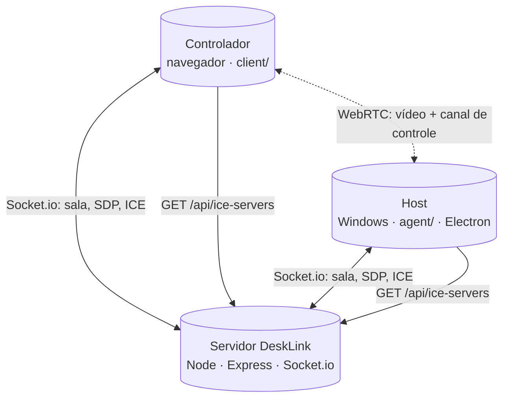

# DeskLink

DeskLink é um projeto de acesso remoto em tempo real: um PC compartilha a tela (host) e outro PC controla pelo navegador (controlador). Vídeo e comandos trafegam por WebRTC; o servidor Node faz a sinalização da sessão e fornece configuração ICE.

## 📌 Status do projeto

- Estágio atual: protótipo funcional com foco em uso pessoal e evolução incremental.
- Plataformas: host em Windows x64 (Electron) e controlador em navegador moderno.
- Escopo atual: 1 host + 1 controlador por sessão.

## ✨ Recursos principais

- Streaming de tela com WebRTC.
- Controle remoto de mouse e teclado.
- Troca de monitor remoto em hosts com múltiplos displays (`F8` no controlador).
- Modo somente visualização (desabilita envio de input).
- Sincronização opcional de clipboard (texto) entre controlador e host.
- Ajuste de sensibilidade de rolagem em tempo real (baixa/média/alta).

---

## 🏗️ Arquitetura

| Pacote | Papel | Tecnologias principais |
|--------|-------|-------------------------|
| `server/` | Sinalização entre peers, API e arquivos estáticos do controlador em produção | Node.js, Express, Socket.io |
| `client/` | Aplicação web do controlador (vídeo remoto + envio de comandos) | Vite, TypeScript, socket.io-client, WebRTC |
| `agent/` | Aplicativo host desktop (captura de tela + injeção de input no SO) | Electron, TypeScript, nut-js |

Fluxo simplificado:



Observação: o tráfego de mídia não passa pelo processo Node do DeskLink; passa entre peers (direto ou via TURN, quando necessário).

---

## 🧰 Stack e tecnologias

- Runtime: Node.js 18+.
- Backend: Express + Socket.io.
- Frontend controlador: Vite + TypeScript.
- App host: Electron + TypeScript + esbuild.
- Automação de build do host: electron-builder.
- Input nativo no host: `@nut-tree-fork/nut-js`.

---

## ✅ Pré-requisitos

| Item | Detalhe |
|------|---------|
| Node.js | 18+ ([nodejs.org](https://nodejs.org)) |
| Sistema para host | Windows x64 |
| Build nativo (quando necessário) | Visual Studio Build Tools com workload "Desktop development with C++" (pode ser exigido por dependências nativas) |

---

## 🚀 Quick start (desenvolvimento local)

```bash
git clone <seu-repositorio>
cd DeskLink
npm install
```

🔹 Terminal 1 (server + client):

```bash
npm run dev
```

🔹 Terminal 2 (agent host):

```bash
npm run dev -w agent
```

📍 Endpoints em dev:

- API/Socket.io: `http://localhost:3000`
- Controlador web: `http://localhost:5173` (com proxy para `/api` e `/socket.io`)

🧭 Fluxo de uso:

1. Inicie `npm run dev`.
2. No host (Electron), informe `http://localhost:3000`, copie o UUID e inicie compartilhamento.
3. No controlador (navegador), use a mesma URL + mesmo UUID e conecte.

---

## 🖥️ Uso durante a sessão

- Clique na área remota para capturar mouse/teclado no controlador.
- "Habilitar controle remoto" desmarca para modo somente visualização.
- `F8` (ou botão de monitor) alterna monitor remoto ativo quando houver múltiplos displays.
- A rolagem usa normalização e coalescência para reduzir picos de eventos.
- O seletor de sensibilidade de rolagem aplica sem reconectar (baixa/média/alta).
- Para comandos de sistema, prefira o painel de atalhos.

---

## 🏭 Rodando em produção

```bash
npm run build
npm run start -w server
```

O servidor entrega `client/dist` e a API na mesma origem (recomendado para reduzir problemas de CORS).

### 🔐 Variáveis de ambiente (`server/.env`)

```bash
cp server/.env.example server/.env
```

| Variável | Uso |
|----------|-----|
| `PORT` | Porta HTTP (padrão `3000`) |
| `CLIENT_ORIGIN` | CORS (em produção, defina origem real do controlador) |
| `METERED_DOMAIN` / `METERED_API_KEY` | Configuração TURN via Metered |
| `ICE_SERVERS_JSON` | Lista ICE estática (substitui Metered quando definida) |

Não faça commit de `.env` com chaves reais.

---

## 🌐 ICE, STUN e TURN

- `GET /api/ice-servers` fornece a configuração ICE para host e controlador.
- STUN ajuda descoberta de endereço para tentativa P2P.
- TURN faz relay quando conexão direta falha (comum entre redes/NAT diferentes).
- Em internet real, TURN costuma ser necessário para boa taxa de conexão.

Exemplo Metered em `server/.env`:

```env
METERED_DOMAIN=desklink.metered.live
METERED_API_KEY=sua_chave_aqui
```

Exemplo de lista estática (`ICE_SERVERS_JSON`, PowerShell):

```powershell
$env:ICE_SERVERS_JSON='[{"urls":["turn:turn.example.com:3478"],"username":"u","credential":"p"}]'
```

---

## 🛠️ Helpers e scripts de operação

### 📦 Scripts NPM (raiz)

- `npm run dev`: sobe server + client em paralelo.
- `npm run build`: build de client, server e agent.
- `npm run start`: inicia servidor compilado.

### 🖥️ Scripts Windows (raiz)

| Arquivo | Função |
|---------|--------|
| `desklink-server.bat` | Instala dependências se necessário, compila client/server quando faltar `dist` e inicia servidor |
| `desklink-build-agent.bat` | Build completo e empacotamento do host para `agent/release/` |
| `desklink-tunnel.bat` | Túnel Cloudflare para expor `localhost:3000` |

### 🧱 Build/release do Agent (pontos importantes)

- `npm run pack -w agent` roda `build-icon` antes do `electron-builder`.
- `build-icon` gera `agent/build/icon.ico` a partir de `agent/build/icon.png`.
- O `desklink-build-agent.bat` pode restaurar `icon-wide-backup.png` e executar `crop-icon-banner.mjs` (se existir) antes de empacotar.
- O controlador usa `GET /api/brand-icon`, servido de `agent/build/icon.png`; em deploy/CI, garanta esse arquivo no host do servidor.

---

## 🧪 Testes e validação

Atualmente o repositório não possui suíte automatizada de testes (unitários/de integração/e2e) nem scripts de lint dedicados na raiz.

Validação recomendada antes de publicar release:

1. `npm install`
2. `npm run build`
3. `npm run pack -w agent` (ou `desklink-build-agent.bat`)
4. Validar manualmente:
   - conexão host/controlador;
   - troca de monitor remoto (`F8`);
   - rolagem em baixa/média/alta;
   - clipboard opcional habilitado;
   - endpoint `GET /api/brand-icon`.

---

## 🩺 Troubleshooting rápido

- Não conecta entre redes diferentes: revise TURN (`METERED_*` ou `ICE_SERVERS_JSON`).
- Só funciona na rede local: normalmente faltando TURN ou problema de NAT/firewall.
- Controle não atua em tela UAC/elevada: limitação conhecida de contexto no Windows.
- Logo/favicon não aparece no controlador: valide a existência de `agent/build/icon.png` no ambiente do servidor.
- Falha em dependências nativas no install: instalar Build Tools C++ no Windows.

---

## 🗂️ Estrutura do repositório

| Pasta | Conteúdo |
|-------|----------|
| `server/` | API HTTP, Socket.io, salas por UUID, endpoint ICE |
| `client/` | SPA do controlador |
| `agent/` | Electron host, preload, renderer, empacotamento |

---

## ⚠️ Limites atuais

- Uma sessão com 1 host e 1 controlador.
- Sem transferência de arquivos e sem chat.
- Atalhos `Win+...` podem ser interceptados pelo SO local do controlador.
- Layouts de teclado muito diferentes podem causar variação em atalhos/composições.
- Clipboard sincroniza apenas texto, com limite aproximado de 256 KB por envio.

---

## 🤝 Contribuição

Contribuições são bem-vindas via issue e pull request. Para ajudar no review:

- Descreva claramente o problema e o contexto;
- Explique a estratégia adotada;
- Inclua passos objetivos de validação manual.

---

## 🔒 Segurança e privacidade

- O DeskLink permite controle remoto real de mouse e teclado; use em redes e ambientes confiáveis.
- Clipboard sincronizado pode transportar dados sensíveis (senhas/tokens); mantenha desabilitado quando não precisar.
- Se identificar vulnerabilidade, abra issue privada com detalhes de reprodução e impacto.

---

## 📄 Licença

Projeto de código aberto para fins educacionais ou uso pessoal. Contribuições são bem-vindas.

---

## 📧 Contato

- **Email:** davilopesramiro@gmail.com  
- **GitHub:** [ramirodavi](https://github.com/ramirodavi/)
