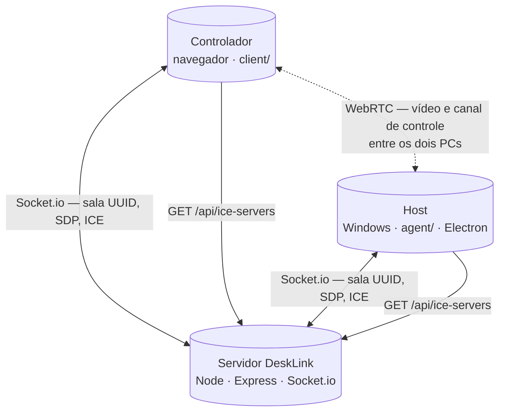

# DeskLink

Acesso remoto em tempo real: um PC **compartilha a tela** e o outro **vê e controla** pelo navegador. O vídeo e os comandos (mouse, teclado, clipboard opcional) trafegam em **WebRTC**; um **servidor Node** só coordena quem entra na sessão e troca as mensagens iniciais (sinalização).

---

## Arquitetura em três partes

| Pacote | O que é | Tecnologias principais |
|--------|---------|-------------------------|
| **`server/`** | Processo que fica **sempre acessível na rede** (VPS, seu PC com IP/túnel, etc.). Junta host e controlador na “sala” da sessão, repassa SDP/ICE e serve a **API** de servidores ICE. | **Node.js**, **Express** (HTTP + arquivos estáticos do controlador em produção), **Socket.io** (WebSocket com fallback). |
| **`client/`** | **Página web** do controlador: vídeo remoto, captura de mouse/teclado no overlay, atalhos. Não instala nada no PC de quem só assiste. | **Vite**, **TypeScript**, **socket.io-client**, WebRTC (`RTCPeerConnection`). |
| **`agent/`** | **App desktop** no Windows (Electron) que roda no PC a ser controlado: captura de tela e injeção de entrada no SO. | **Electron** (`desktopCapturer`, janela), **nut-js** (fork) para mouse/teclado. |

**Por que não é “só um site”?** O navegador não pode, sozinho, capturar o monitor inteiro de forma estável no cenário host nem injetar entrada no sistema como um app nativo — por isso o host usa **Electron**. O controlador pode ser só navegador porque só precisa **reproduzir** o stream e **enviar** eventos.

**Sinalização vs mídia:** **Socket.io** leva mensagens pequenas e rápidas (ofertas/respostas SDP, candidatos ICE, “quem entrou na sala”). O **vídeo** e o **canal de controle** usam WebRTC **entre os dois PCs** (peer-to-peer), não passam pelo Express byte a byte. O servidor precisa estar no ar para os dois **se encontrarem** e **negociarem** essa conexão.

Fluxo geral (sinalização pelo servidor; mídia direta entre peers ou relay TURN quando necessário):



A linha tracejada é o caminho de **mídia WebRTC** (em muitos cenários P2P; se NAT/firewall impedirem, o tráfego pode ir **via TURN**, ainda sem passar pelo processo Node do DeskLink).

---

## O que precisa existir na internet (visão geral)

Para **dois computadores em redes diferentes** conseguirem sessão:

1. **Um URL público** onde o **servidor DeskLink** responda (HTTP + Socket.io + `/api`). Host e controlador usam **o mesmo endereço base** (ex.: `https://desklink.exemplo.com` ou URL do túnel).
2. **Servidores ICE** (STUN e, na prática, **TURN** entre redes/NAT). O cliente e o agent obtêm a lista em **`GET /api/ice-servers`**. Sem TURN, muitas combinações de NAT/firewall **não** estabelecem vídeo — por isso o projeto integra **Metered** ou lista estática via env.
3. **Túnel (opcional)** se você não tiver VPS nem IP público: **Cloudflare Tunnel**, **ngrok**, etc. expõem o `localhost:3000`; o URL gerado vira o “servidor” para host e controlador.

Nada disso substitui **você** hospedar ou expor o processo Node; o repositório só fornece o código desse servidor e dos clientes.

---

## Pré-requisitos

| Item | Detalhe |
|------|---------|
| **Node.js** | **18+** ([nodejs.org](https://nodejs.org)) |
| **Host** | **Windows x64** (build portátil testado nesta plataforma) |
| **Build do agente (dev)** | Para `@nut-tree-fork/libnut`, o `postinstall` pode precisar de **Visual Studio Build Tools** com workload *Desktop development with C++* se houver recompilação nativa |

---

## Instalação (raiz do repositório)

```bash
git clone <seu-repositório>
cd DeskLink
npm install
```

---

## Desenvolvimento local

**Terminal 1** — API + UI (em dev o Vite faz proxy para o servidor):

```bash
npm run dev
```

- **API / Socket.io:** `http://localhost:3000`
- **Controlador (Vite):** `http://localhost:5173` — use no navegador; o proxy encaminha `/api` e `/socket.io` para a porta 3000

**Terminal 2** — app host (Electron):

```bash
npm run dev -w agent
```

### Fluxo recomendado (ordem importa)

1. **Servidor** rodando (`npm run dev`).
2. **Host (Electron):** informe o **URL do servidor** (em dev: `http://localhost:3000`), aguarde **Conectado**, copie o **código UUID** e **Iniciar compartilhamento**.
3. **Controlador (navegador):** mesmo **URL do servidor**, mesmo **código**, **Conectar**. O controlador só entra se o host já tiver iniciado o compartilhamento.

---

## Produção (servir UI + API)

```bash
npm run build
npm run start -w server
```

O servidor entrega `client/dist` e a API. Abra `http://localhost:3000` (ou host/porta do `.env`). Em produção, controle e API costumam compartilhar a **mesma origem** (evita problemas de CORS).

### Variáveis de ambiente (`server/.env`)

```bash
cp server/.env.example server/.env
```

| Variável | Uso |
|----------|-----|
| `PORT` | Porta HTTP (padrão `3000`) |
| `CLIENT_ORIGIN` | CORS: em produção, origem real do controlador (ex. `https://desklink.seudominio.com`) ou `*` só em testes |
| `METERED_DOMAIN` / `METERED_API_KEY` | TURN via [Metered](https://www.metered.ca/) — ver seção ICE |
| `ICE_SERVERS_JSON` | Lista ICE estática (se definida, **substitui** Metered) |

Não faça commit de `.env` com chaves reais.

### Scripts Windows (raiz)

| Arquivo | Função |
|---------|--------|
| [desklink-server.bat](desklink-server.bat) | Dependências, compila client/server se faltar `dist`, sobe o servidor |
| [desklink-build-agent.bat](desklink-build-agent.bat) | Build client + server + `npm run pack -w agent` → `agent/release/` (`DeskLinkHost-*-portable.exe`) |
| [desklink-tunnel.bat](desklink-tunnel.bat) | (Opcional) Túnel Cloudflare para expor `localhost:3000` |

---

## ICE / STUN / TURN (tráfego WebRTC na internet)

**ICE** (*Interactive Connectivity Establishment*) é o **procedimento** que o WebRTC usa para descobrir **como** dois programas podem trocar dados na rede: testa caminhos (IPs/portas) até achar um que funcione atrás de NAT e firewall. A “lista de servidores” que ajudam nessa descoberta é a configuração **ICE** — no DeskLink ela vem do endpoint `GET /api/ice-servers`.

Dois tipos de servidor costumam aparecer nessa lista:

| Sigla | Nome (inglês) | Função em uma frase |
|-------|----------------|----------------------|
| **STUN** | *Session Traversal Utilities for NAT* | Responde “qual é o meu endereço visto da internet?” para que os peers tentem ligar **direto** um ao outro sem passar o vídeo por um intermediário. |
| **TURN** | *Traversal Using Relays around NAT* | Quando a ligação direta **não** é possível, os dois lados mandam o tráfego **por esse servidor**, que faz de ponte (relay). É mais pesado e por isso normalmente exige credenciais ou serviço pago. |

Em resumo: **STUN** tenta P2P; **TURN** garante conectividade quando o P2P falha. O DeskLink já usa um **STUN** público por padrão; para dois PCs em redes diferentes, na prática é **necessário** configurar **TURN** (Metered ou `ICE_SERVERS_JSON` abaixo).

### Metered (recomendado)

1. Crie um app em [Metered](https://www.metered.ca/), copie **domínio** e **API Key**.
2. Em `server/.env`:

```env
METERED_DOMAIN=desklink.metered.live
METERED_API_KEY=sua_chave_aqui
```

O endpoint `GET /api/ice-servers` devolve as credenciais (com cache curto).

### Lista estática (`ICE_SERVERS_JSON`)

Se definir no ambiente, **substitui** Metered. Exemplo (PowerShell):

```powershell
$env:ICE_SERVERS_JSON='[{"urls":["turn:turn.example.com:3478"],"username":"u","credential":"p"}]'
```

---

## Túnel (sem IP público / sem abrir porta)

Se houver **CGNAT** ou impossibilidade de abrir porta, use **Cloudflare Quick Tunnel** ou similar para publicar o processo local.

1. Baixe [cloudflared](https://github.com/cloudflare/cloudflared/releases) (`cloudflared-windows-amd64.exe`), renomeie para `cloudflared.exe` na raiz do repo.
2. Uma janela: [desklink-server.bat](desklink-server.bat) (`http://localhost:3000`).
3. Outra: [desklink-tunnel.bat](desklink-tunnel.bat) ou `cloudflared tunnel --url http://localhost:3000`.

O URL `https://….trycloudflare.com` é o endereço **público** — use no controlador e no campo do servidor do host (sem barra final). URLs gratuitas podem **mudar** a cada execução. **Metered** continua recomendado para WebRTC entre redes diferentes.

Alternativa: [ngrok](https://ngrok.com/) (`ngrok http 3000`).

---

## Pastas do repositório

| Pasta | Conteúdo |
|-------|----------|
| `server/` | Entrada HTTP, Socket.io, salas por UUID, relay de sinalização, `GET /api/ice-servers` |
| `client/` | SPA do controlador: vídeo, overlay de entrada, atalhos, sync opcional de clipboard |
| `agent/` | Processo principal Electron, preload, renderer do host, `electron-builder` para `.exe` portátil |

---

## Limitações

- **Um par** host/controlador por sessão (UUID).
- Sem chat nem transferência de arquivos.
- Controle pode falhar em prompts elevados (UAC) ou fora da sessão do usuário no Windows.
- Atalhos **Win+…** no controlador podem ser interceptados pelo SO local; o painel de atalhos envia sequências pelo DataChannel.
- **Clipboard (opcional):** checkbox no controlador; só texto; ~256 KB por envio; desligado por padrão; navegador pode pedir permissão de leitura; trate senhas/tokens com cuidado.
